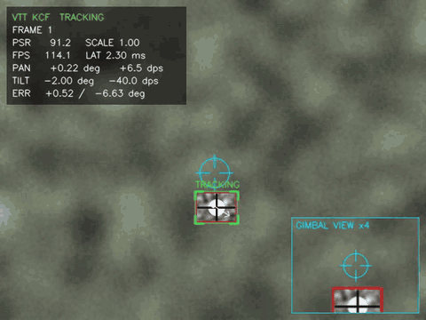

# vision-target-tracker

**Real-time visual target tracker for gimbal control: MOSSE/KCF correlation filters, scale estimation, PSR confidence, Kalman prediction through occlusion and a PID-driven pan/tilt loop — in dependency-light C++17.**

[](https://github.com/bekirhankarakurt/vision-target-tracker/actions/workflows/ci.yml)
[](https://github.com/bekirhankarakurt/vision-target-tracker/actions/workflows/codeql.yml)
[](https://bekirhankarakurt.github.io/vision-target-tracker/coverage/)
[](https://github.com/bekirhankarakurt/vision-target-tracker/releases)
[](LICENSE)


**[Documentation](https://bekirhankarakurt.github.io/vision-target-tracker/)** · [API reference](https://bekirhankarakurt.github.io/vision-target-tracker/api/) · [Coverage report](https://bekirhankarakurt.github.io/vision-target-tracker/coverage/) · [Releases](https://github.com/bekirhankarakurt/vision-target-tracker/releases)

## Why / what

- **Electro-optical tracking loop end to end:** capture → correlation tracker → Kalman → PID gimbal → telemetry overlay, the same chain used in EO/IR pods and UAV camera turrets.
- **Tracker maths implemented from scratch** (FFT via `cv::dft` only): MOSSE, Gaussian-kernel KCF on intensity + gradient features, DSST-style scale filter, PSR confidence. No `cv::Tracker*`, no HOG, no ML runtime.
- **Robust to occlusion:** PSR gating, constant-velocity Kalman coasting, `TRACKING → OCCLUDED → LOST` state machine with an expanding search grid for reacquisition.
- **Real time on a CPU core:** 1.9 ms (MOSSE) / 2.5 ms (KCF) mean per-frame latency at 640×480, including scale estimation.
- **Measurable:** deterministic synthetic sequence with ground truth; CI fails if mean IoU drops below 0.65 or centre error exceeds 8 px.

## Demo



*Synthetic test sequence (`vtt_synth`) tracked by KCF. Green corners = TRACKING, amber = OCCLUDED (Kalman coasting), red = LOST (grey rectangle = expanding search region). Cyan reticle = simulated gimbal boresight; bottom-right inset = narrow-FOV payload view (×4).*

## Quick start (60 s)

```bash
sudo apt-get install -y build-essential cmake libopencv-dev
git clone https://github.com/bekirhankarakurt/vision-target-tracker.git
cd vision-target-tracker
cmake -S . -B build && cmake --build build -j
ctest --test-dir build
```

```bash
./build/vtt                     # webcam 0: draw a box around the target, press ENTER
```

No camera? Generate the synthetic sequence and track it headless:

```bash
./build/vtt_synth --out synthetic.avi --gt synthetic_gt.csv
./build/vtt --input synthetic.avi --gt synthetic_gt.csv --headless
```

## Requirements

| Item | Version | Notes |
|---|---|---|
| C++ compiler | GCC ≥ 9 or Clang ≥ 10 | C++17; CI uses GCC 13 and Clang 18 |
| CMake | ≥ 3.16 | |
| OpenCV | 4.x | `core`, `imgproc`, `videoio`, `highgui` only (Ubuntu: `libopencv-dev`) |
| OS | Linux x86-64 | Tested on Ubuntu 24.04; the code is portable C++ |
| ffmpeg | optional | Only for `scripts/make_demo.sh` |

### Build options

| Option | Default | Effect |
|---|---|---|
| `CMAKE_BUILD_TYPE` | `Release` | `Debug` for sanitizers/coverage |
| `VTT_BUILD_APPS` | `ON` | Build `vtt` and `vtt_synth` |
| `VTT_BUILD_TESTS` | `ON` | Build unit/integration tests (CTest) |
| `VTT_WARNINGS_AS_ERRORS` | `OFF` | Add `-Werror` (on in CI) |
| `VTT_ENABLE_SANITIZERS` | `OFF` | AddressSanitizer + UndefinedBehaviorSanitizer |
| `VTT_ENABLE_COVERAGE` | `OFF` | gcov instrumentation for `gcovr` |
| `VTT_NATIVE_ARCH` | `OFF` | `-march=native` |

## Usage

```text
vtt [options]
  -i, --input PATH          Video file (default: webcam)       --camera N        Webcam index (0)
      --algo mosse|kcf      Correlation filter (kcf)           --roi x,y,w,h     Initial box (default: mouse)
      --no-scale            Disable scale estimation           --psr-threshold X Override tracking PSR gate
      --hfov DEG            Scene camera FOV (60)              --max-rate DPS    Gimbal rate limit (120)
      --pid-kp/-ki/-kd X    PID gains (10 / 20 / 0.1)          --max-accel DPS2  Gimbal accel limit (600)
      --headless            No window (needs --roi or --gt)    --csv PATH        Per-frame telemetry CSV
      --output PATH         Overlay video (MJPG .avi)          --max-frames N    Stop after N frames
      --gt PATH             Ground truth CSV (frame,x,y,w,h)   --min-iou X / --max-center-error PX  exit 2 if violated
```

Run `./build/vtt --help` for the full text. At exit `vtt` prints latency (mean/p50/p95/max), throughput and, with `--gt`, mean IoU, centre error, success rate and precision.

### Keyboard controls

| Key | Action |
|---|---|
| `q` / `Esc` | Quit |
| `Space` | Pause / resume |
| `r` | Re-select the target with the mouse |
| `a` | Switch MOSSE ↔ KCF (re-initialised on the current box) |
| `g` | Toggle the gimbal payload inset |
| `c` | Re-centre the gimbal |
| `h` | Toggle the help panel |

### Recipes

**Webcam with mouse selection** (laptop camera, KCF):

```bash
./build/vtt --camera 0 --algo kcf
```

**Video file with a known start box, saving telemetry and an annotated video:**

```bash
./build/vtt --input synthetic.avi --roi 288,284,64,48 --csv track.csv --output annotated.avi
```

**Headless benchmark with accuracy gates** (what CI runs):

```bash
./build/vtt --input synthetic.avi --gt synthetic_gt.csv --algo mosse --headless --min-iou 0.65 --max-center-error 8
```

**Gimbal simulation tuning** — slower, softer turret and a narrower scene camera; compare `pan_err_deg`/`tilt_err_deg` in the CSV:

```bash
./build/vtt --input synthetic.avi --gt synthetic_gt.csv --headless --hfov 40 --pid-kp 6 --pid-ki 8 --pid-kd 0.05 --max-rate 60 --max-accel 200 --csv gimbal.csv
```

**Harder occlusion** (35 frames fully hidden while the target moves and shrinks → LOST, then reacquired; mean IoU ≈ 0.80):

```bash
./build/vtt_synth --out long_occlusion.avi --gt long_occlusion_gt.csv --occlusion-hold 35
./build/vtt --input long_occlusion.avi --gt long_occlusion_gt.csv --headless --csv long.csv
```

## Architecture

```text
 ┌──────────┐  BGR   ┌──────────────────────────────────────────┐  centre, ┌──────────────┐ bearing ┌───────────────────┐
 │ Capture  │──────▶│ Tracker                                  │  state   │ Kalman (CV)  │ (deg)   │ Gimbal sim        │
 │ webcam / │       │  gray → patch (padding 2.5, 64 px²)       │────────▶│ x=[px py vx vy]│──────▶│ PID pan + PID tilt│
 │ file     │       │  MOSSE | KCF response → peak, PSR         │◀────────│ predict/correct│        │ rate/accel/angle  │
 └──────────┘       │  1-D scale filter (15 levels)             │ prior    └──────────────┘        │ limits, boresight │
                    │  state machine TRACKING/OCCLUDED/LOST     │                                   └─────────┬─────────┘
                    └───────────────┬──────────────────────────┘                                             │
                                    │ TrackOutput (box, psr, scale, search region)                          │ GimbalState
                                    ▼                                                                         ▼
                    ┌──────────────────────────────────────────────────────────────────────────────────────────────┐
                    │ Overlay (box, reticle, payload inset, HUD) · CSV telemetry · accuracy/latency statistics     │
                    └──────────────────────────────────────────────────────────────────────────────────────────────┘
```

Per frame: Kalman **predict** → correlate at the predicted centre (round-robin grid of centres × scales when LOST, plus one re-centred re-evaluation of the best peak) → **PSR gate** → on success: scale filter, Kalman **correct**, model update (only if PSR ≥ update threshold); on failure: coast on the prior. The gimbal tracks the measured centre while TRACKING/OCCLUDED and decelerates to rest when LOST.

### Design trade-offs

| Decision | Why | Cost |
|---|---|---|
| Fixed 64×64-equivalent patch, resized from a padded window | Constant FFT cost regardless of target size | Small targets are upsampled (no extra detail) |
| Separate 1-D scale filter instead of a 3-level translation pyramid | The pyramid approach drifted to small scales with KCF (IoU 0.39 → 0.91 after the switch) | +1.2 ms per frame |
| PSR gating with separate track/update/reacquire thresholds | Prevents model corruption by occluders; hysteresis avoids flicker | Short partial occlusions may trigger OCCLUDED |
| Constant-velocity Kalman on the centre only | Simple, observable, good for 0.3–1 s gaps | Manoeuvring targets drift during long occlusions |
| Velocity damping + expanding grid × 3 scale hypotheses when LOST, swept round-robin | Finds targets that moved and changed size while hidden at a fixed cost (24 windows per frame) | A full sweep takes several frames, so reacquisition lags by a few frames |
| Gimbal driven from the wide scene camera bearing | Runs on any webcam/video without hardware | Gimbal motion does not feed back into the image |
| Hand-written test harness (no GoogleTest) | Single dependency, fast CI | Fewer assertion helpers |

## Algorithm notes

**MOSSE** (Bolme et al., 2010). With preprocessed patch $f$ (log, zero-mean/unit-variance, cosine window), desired Gaussian response $g$ and $\hat{\cdot}$ the 2-D DFT:

$$H^{*}=\frac{A}{B},\qquad A_t=\eta\,\hat{G}\odot\hat{F}_t^{*}+(1-\eta)A_{t-1},\qquad B_t=\eta\,\hat{F}_t\odot\hat{F}_t^{*}+(1-\eta)B_{t-1}$$

Response $r=\mathcal{F}^{-1}(\hat{Z}\odot H^{*})$. The filter is initialised from 8 randomly rotated/scaled copies of the first patch.

**KCF with a Gaussian kernel** (Henriques et al., 2015), features $x$ = {intensity, $\partial_x$, $\partial_y$}, $C=3$ channels, $N$ pixels:

$$k^{xz}=\exp\!\left(-\frac{1}{\sigma^{2}NC}\max\!\Big(0,\ \lVert x\rVert^{2}+\lVert z\rVert^{2}-2\,\mathcal{F}^{-1}\big(\textstyle\sum_c \hat{x}_c^{*}\odot\hat{z}_c\big)\Big)\right)$$

$$\hat{\alpha}=\frac{\hat{y}}{\hat{k}^{xx}+\lambda},\qquad r=\mathcal{F}^{-1}\big(\hat{k}^{xz}\odot\hat{\alpha}\big)$$

**Scale** (DSST-style): $S=15$ samples at $a^{n}$, $a=1.025$, each a $D$-dimensional feature vector; a 1-D MOSSE filter across the scale dimension picks $n^{*}=\arg\max r(n)$ and $s\leftarrow s\,a^{n^{*}}$.

**Confidence** — peak-to-sidelobe ratio over the response excluding an 11×11 window around the peak:

$$\mathrm{PSR}=\frac{r_{\max}-\mu_{\text{side}}}{\sigma_{\text{side}}}$$

**Kalman** (constant velocity, white-noise acceleration $q$, $\Delta t$ = 1 frame):

$$x_{k}=Fx_{k-1},\quad P_k=FP_{k-1}F^{\top}+Q,\quad F=\begin{bmatrix}I&\Delta t\,I\\0&I\end{bmatrix},\quad Q=q\begin{bmatrix}\tfrac{\Delta t^4}{4}I&\tfrac{\Delta t^3}{2}I\\\tfrac{\Delta t^3}{2}I&\Delta t^2 I\end{bmatrix}$$

$$K=PH^{\top}(HPH^{\top}+R)^{-1},\quad x\leftarrow x+K(z-Hx),\quad P\leftarrow(I-KH)P(I-KH)^{\top}+KRK^{\top}$$

**Gimbal PID** per axis, error $e$ = target bearing − gimbal angle (pinhole model, $f=\tfrac{W/2}{\tan(\mathrm{HFOV}/2)}$, $\theta=\operatorname{atan2}(u-c_u,f)$):

$$u=K_p e+K_i\!\int e\,dt+K_d\,\dot e_{\text{filt}},\qquad \omega_{k}=\omega_{k-1}+\operatorname{clamp}\!\big(\operatorname{clamp}(u,\pm\omega_{\max})-\omega_{k-1},\ \pm\alpha_{\max}\Delta t\big)$$

Anti-windup: the integrator freezes while the output is saturated in the direction of the error, and $|\int e|$ is clamped. The derivative uses a first-order low-pass ($\tau$ = 20 ms).

## Benchmark

Synthetic sequence, 640×480, 300 frames (target 64×48 at scale 0.7–1.3, 26-frame occlusion), Release build, GCC 13, single process on an Intel Xeon @ 2.1 GHz (4 vCPU cloud VM). Latency = `Tracker::update` only; pipeline FPS includes video decoding.

| Configuration | Mean latency | p95 latency | Tracker FPS | Pipeline FPS | Mean IoU | Centre error |
|---|---|---|---|---|---|---|
| MOSSE + scale | 1.95 ms | 3.83 ms | 513 | 341 | 0.912 | 3.4 px |
| KCF + scale (default) | 2.49 ms | 9.11 ms | 401 | 294 | 0.911 | 3.5 px |
| MOSSE, `--no-scale` | 0.56 ms | 1.40 ms | 1795 | 678 | 0.655 | 2.4 px |
| KCF, `--no-scale` | 1.35 ms | 3.56 ms | 739 | 441 | 0.644 | 3.9 px |
| KCF, 35-frame full occlusion (`--occlusion-hold 35`) | — | — | — | — | 0.799 | 22.9 px |

All configurations stay an order of magnitude inside the 33 ms real-time budget at 30 FPS; the p95 tail comes from LOST frames, which evaluate a 24-window search sweep. Without scale estimation IoU collapses as the target grows and shrinks, even though the centre error stays low. Reproduce with:

```bash
./build/vtt --input synthetic.avi --gt synthetic_gt.csv --headless --algo kcf
```

## Testing

```bash
ctest --test-dir build --output-on-failure
```

| Suite | What it checks |
|---|---|
| `unit.spectral` | FFT round trip, complex division, Parseval, sub-pixel peak, PSR |
| `unit.filters` | MOSSE/KCF recover known translations (±0.6 px), adapt to appearance change, reject other textures |
| `unit.scale` | Scale filter converges to ±10 % size changes |
| `unit.kalman` | Velocity convergence, prediction through gaps, covariance symmetry |
| `unit.control` | PID saturation, anti-windup, integral clamp; gimbal convergence, rate/accel/angle limits |
| `unit.tracking` | Full pipeline on synthetic video: IoU > 0.65, centre error < 8 px, OCCLUDED during occlusion, LOST → reacquire |
| `unit.utils` | Metrics, CLI parsing, CSV I/O, overlay rendering |
| `integration.*` | `vtt_synth` → `vtt --headless --gt --min-iou 0.65 --max-center-error 8` for both algorithms, overlay video |

CI additionally runs the suite under ASan/UBSan, clang-tidy (`.clang-tidy`, warnings as errors), cppcheck and CodeQL, and publishes coverage to GitHub Pages.

## Troubleshooting / FAQ

**`error: cannot open camera`** — check `ls /dev/video*`, try `--camera 1`, and make sure your user is in the `video` group (`sudo usermod -aG video $USER`, then log out/in).

**`Could not find a package configuration file provided by "OpenCV"`** — install `libopencv-dev`, or point CMake at your build: `cmake -S . -B build -DOpenCV_DIR=/path/to/opencv/lib/cmake/opencv4`.

**No window / `cannot connect to X server`** — you are on a headless machine; use `--headless --roi x,y,w,h` (or `--gt`) and `--output annotated.avi`.

**The box drifts onto the background** — select a tighter box around the target only, try `--algo mosse` for highly textured targets, or raise the gate with `--psr-threshold 8`.

**Target goes OCCLUDED too often on a noisy webcam** — lower the gate (`--psr-threshold 4.5`); the PSR is shown live in the HUD.

**Released binary fails with `libopencv_*.so.406: not found`** — the release tarball links OpenCV dynamically; install `libopencv-dev` (Ubuntu 24.04) or build from source.

## Project structure

```text
.
├── apps/
│   ├── vtt.cpp              # tracker application: capture, GUI/headless loop, CSV, summary
│   └── vtt_synth.cpp        # synthetic sequence + ground-truth generator
├── include/vtt/             # public headers (documented with Doxygen)
│   ├── tracker.hpp          # pipeline + state machine
│   ├── mosse.hpp kcf.hpp    # translation correlation filters
│   ├── scale_filter.hpp     # 1-D scale filter
│   ├── spectral.hpp         # FFT helpers, peak, PSR
│   ├── features.hpp         # intensity / gradient features
│   ├── kalman.hpp           # constant-velocity Kalman filter
│   ├── pid.hpp gimbal.hpp   # control loop and 2-axis gimbal model
│   ├── synthetic.hpp        # deterministic test scene
│   └── overlay.hpp csv.hpp cli.hpp metrics.hpp types.hpp
├── src/                     # implementations
├── tests/                   # CTest suites + minimal harness, LSan suppressions
├── scripts/                 # demo GIF rendering, coverage badge
├── docs/                    # demo.gif, Doxygen main page, Pages landing page
├── cmake/CompilerOptions.cmake
├── .github/                 # CI, CodeQL, Pages, release workflows, templates, Dependabot
├── Doxyfile  .clang-tidy  CHANGELOG.md  CONTRIBUTING.md  SECURITY.md
└── CMakeLists.txt
```

## Roadmap

- [x] MOSSE and Gaussian-kernel KCF on intensity/gradient features
- [x] Scale estimation, PSR confidence, Kalman coasting, lost/reacquire
- [x] PID gimbal simulation with anti-windup and rate limits
- [x] Synthetic ground-truth sequence and accuracy-gated CI
- [ ] Closed-loop gimbal: crop the scene by the boresight so control affects the image
- [ ] Interacting Multiple Model (CV + CA) filter for manoeuvring targets
- [ ] Thermal (16-bit) input path and contrast normalisation for IR sensors
- [ ] Serial / UDP output of gimbal commands (e.g. MAVLink `GIMBAL_MANAGER_SET_ATTITUDE`)
- [ ] Multi-threaded capture / tracking pipeline and ARM (Jetson, Raspberry Pi) benchmarks

## License

[MIT](LICENSE) © Bekirhan Karakurt

Bekirhan Karakurt - [github.com/bekirhankarakurt](https://github.com/bekirhankarakurt)
